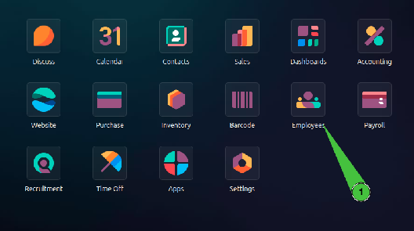
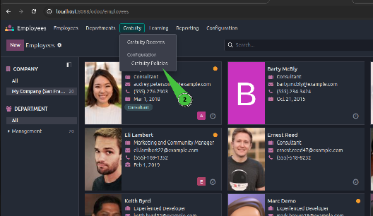
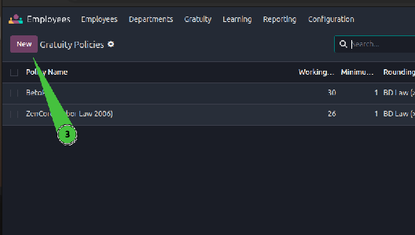
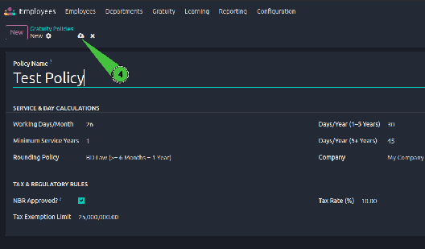
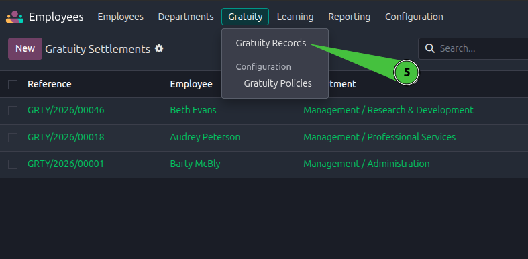
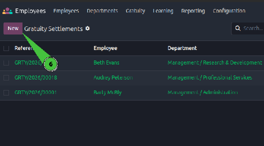
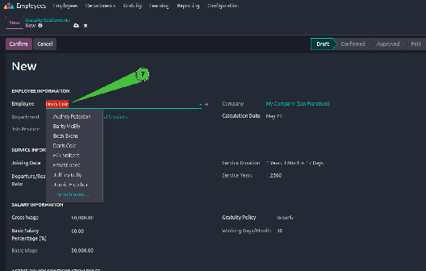
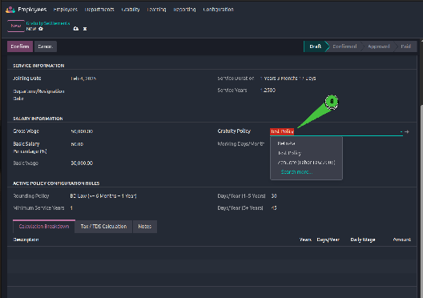
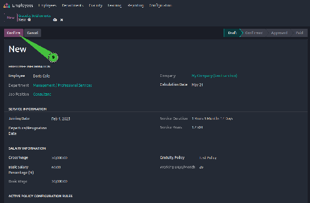
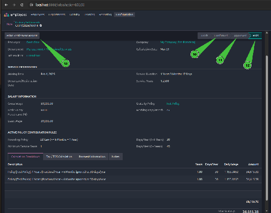

# Custom HR Gratuity & Final Settlement Engine

> **End-User Operations Manual**  
> Comprehensive guide for managing employee terminal benefits and automated gratuity settlements in Odoo v19.

---

## 1. Overview

Managing employee terminal benefits can be highly complex due to evolving company guidelines and shifting localized labor standards. The **Custom HR Gratuity Engine** provides HR administrators with a dynamic, parameter-driven console to automate calculations seamlessly. This module establishes a bulletproof framework to eliminate manual calculation errors, trap transaction duplicates, and isolate processing components.

---

## 2. Key Features

* **Precise Service Tenure Tracking:** Analyzes employment joining and departure timelines to compute exact service history metrics broken down to absolute year fractions, months, and remainder calendar days.
* **Dynamic Rule Multipliers:** Maps unique multipliers dynamically against defined configurations, allowing step-up rules to execute automatically as worker service milestones expand.
* **Withholding Tax & TDS Exemptions:** Configures legal taxation parameters including explicit statutory exemption ceilings, automatically assessing taxable intersections before completing final payments.
* **Strict Duplicate Integrity Guards:** Enforces absolute server-side database validation layer locks, trapping parallel entries instantly to restrict each unique employee profile to exactly one active historical settlement record.

---

## 3. Module Information

| Attribute | Details |
| :--- | :--- |
| **App Name** | Custom HR Gratuity & Final Settlement Engine |
| **Technical Name** | `hr_gratuity` |
| **Supported Version** | Odoo v19.0 (Community & Enterprise) |
| **Dependencies** | `hr`, `mail` |
| **License Type** | LGPL-3 |

---

## 4. Getting Started

To provision customized parameter values matching your corporate policy book, follow the step-by-step operational procedures outlined below. The process is divided into **Administrative Configuration** and **Settlement Processing**.

---

## 5. Administrative Configuration Guide

### Step 1: Open the Employees Application
From the main Odoo dashboard, click on the **"Employees"** app icon to access the HR module.

---

### Step 2: Navigate to Gratuity Policies
In the top menu bar, click on the **"Gratuity"** dropdown menu and select **"Gratuity Policies"**.

---

### Step 3: Create a New Policy
Click the **"New"** button to initialize a fresh configuration matrix for your company rules.

---

### Step 4: Configure Policy Parameters
Enter the Policy Name, Working Days per Month, Service Year Multipliers, and Tax Thresholds. Once all data is filled, save the record.

---

## 6. Processing Gratuity Settlements

### Step 5: Access Gratuity Records
From the top menu, click **"Gratuity"** and then navigate to **"Gratuity Records"** (or Gratuity Settlements).

---

### Step 6: Initiate a New Settlement
Click the **"New"** button to start processing a final settlement for a departing or retiring employee.

---

### Step 7: Select the Target Employee
From the dropdown list, select the employee. The system will automatically fetch their exact joining date and compute the precise service duration.

---

### Step 8: Apply the Gratuity Policy
Select the relevant Gratuity Policy you created earlier. The engine will instantly pull the correct multiplier formulas and days-per-month logic.

---

### Step 9: Confirm the Draft Calculation
Click the **"Confirm"** button. This locks the tenure audit and triggers the strict anti-duplicate validation to secure the database layer.

---

### Step 10: Advance Pipeline and Print Report
Move the record through the approval pipeline (**Confirmed ➔ Approved ➔ Paid**). At any point, click the **"Print Settlement Report"** button to generate the final legal A4 PDF statement.

